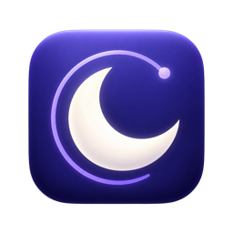
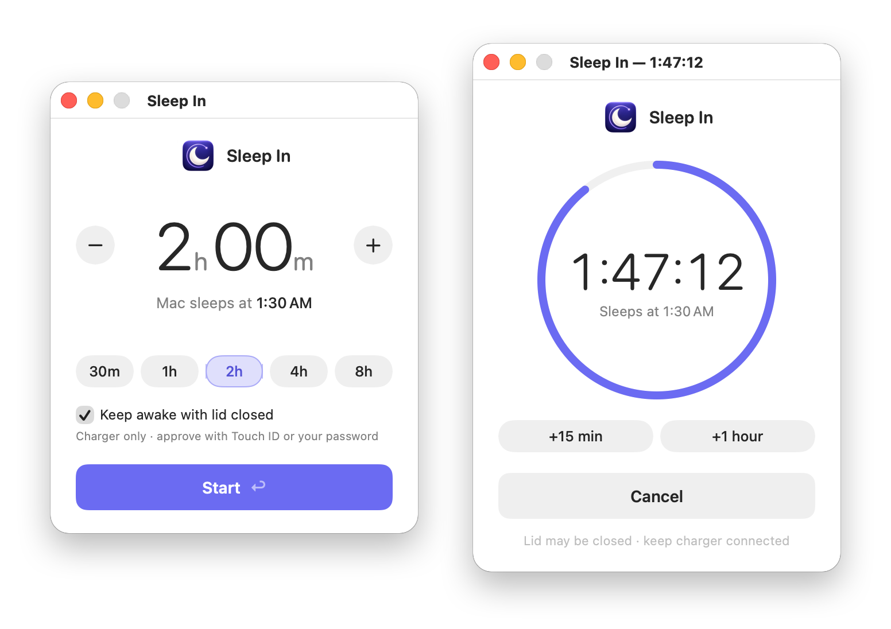
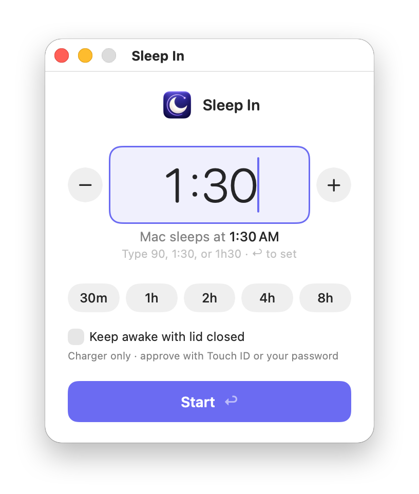
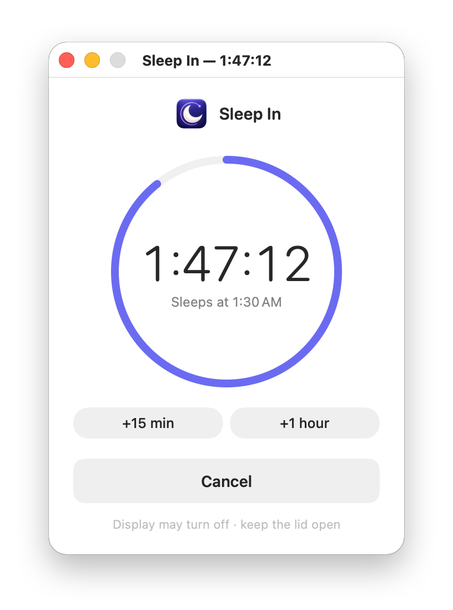
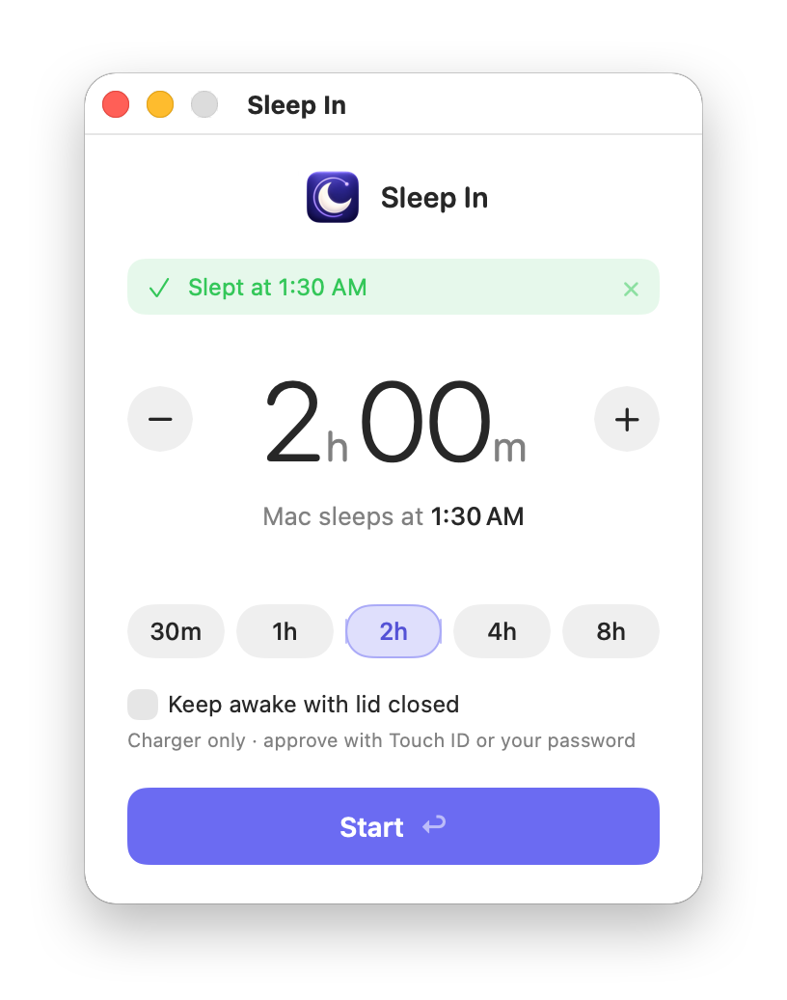

<p align="center">
  
</p>

<h1 align="center">Sleep In</h1>

<p align="center">
  <strong>Keep your Mac awake for a set time, then put it to sleep.</strong>
</p>

<p align="center">
  <a href="https://github.com/qwertyu-alex/sleep-in/actions/workflows/tests.yml"></a>
  
  
  <a href="LICENSE"></a>
</p>

<p align="center">
  <a href="https://github.com/qwertyu-alex/sleep-in/releases/latest"></a>
</p>

<p align="center">
  <picture>
    <source media="(prefers-color-scheme: dark)" srcset="docs/images/hero-dark.png">
    
  </picture>
</p>

Start a long build, a big download, or a coding agent before bed. Sleep In
keeps your Mac working until the countdown ends, then puts it to sleep instead
of leaving it running all night. It even works with the lid closed.

## Features

- **Set it and walk away.** Tap a preset, scroll or drag the number, or just
  type `1:30`. Sleep In shows exactly when your Mac will sleep.
- **Works with the lid closed.** Close your MacBook on the charger and it keeps
  working, with no external display needed. Approve with Touch ID.
- **Puts your settings back.** Normal sleep returns when the timer ends, when
  you cancel, when you unplug, and even if the timer crashes.
- **App or Terminal.** A native SwiftUI app and a `sleep-in` command share one
  timer, so you can start it in one and check it from the other.
- **Native and up to date.** All Swift, with nothing else to install, and it
  updates itself. The privileged helper runs only during a lid-closed session.

## How it works

<table>
  <tr>
    <th width="33%">1. Set a time</th>
    <th width="33%">2. Let it run</th>
    <th width="33%">3. Your Mac sleeps</th>
  </tr>
  <tr>
    <td align="center">
      <picture>
        <source media="(prefers-color-scheme: dark)" srcset="docs/images/set-time-dark.png">
        
      </picture>
    </td>
    <td align="center">
      <picture>
        <source media="(prefers-color-scheme: dark)" srcset="docs/images/countdown-dark.png">
        
      </picture>
    </td>
    <td align="center">
      <picture>
        <source media="(prefers-color-scheme: dark)" srcset="docs/images/slept-dark.png">
        
      </picture>
    </td>
  </tr>
  <tr>
    <td>Pick a preset, or type <code>90</code>, <code>1:30</code>, or <code>1h30</code>. Press <kbd>Return</kbd> to start.</td>
    <td>The countdown keeps your Mac awake. Add time without restarting it.</td>
    <td>When time is up, your Mac goes to sleep. The window shows when it slept.</td>
  </tr>
</table>

## Install

Sleep In runs on macOS 14 Sonoma or later on Apple silicon.

1. Download [**Sleep-In.zip**](https://github.com/qwertyu-alex/sleep-in/releases/latest/download/Sleep-In.zip)
   from the [latest release](https://github.com/qwertyu-alex/sleep-in/releases/latest),
   unzip it, and move **Sleep In** to your Applications folder.
2. Open **Sleep In**. The app is signed and notarized by Apple.

Sleep In keeps itself up to date. It checks for a new version once a day,
downloads it in the background, and installs it the next time you quit. To
check now, choose **Sleep In → Check for Updates…**. Versions before 1.2.0
can't update themselves; download the latest release once to get updates.

To also use the `sleep-in` command in Terminal, link it from the app and add
`~/.local/bin` to your `PATH`:

```sh
mkdir -p ~/.local/bin
ln -s "/Applications/Sleep In.app/Contents/MacOS/sleep-in" ~/.local/bin/sleep-in
```

### Build from source

Building needs Apple's Command Line Tools (`xcode-select --install`) and a
**Developer ID Application** signing certificate from the Apple Developer
Program. Lid-closed mode's privileged helper only trusts code signed by the
same Developer ID team.

```sh
git clone https://github.com/qwertyu-alex/sleep-in.git
cd sleep-in
./gui/build.sh
mkdir -p ~/.local/bin
ln -s "$HOME/Applications/Sleep In.app/Contents/MacOS/sleep-in" ~/.local/bin/sleep-in
```

`build.sh` compiles, signs, and installs `~/Applications/Sleep In.app`,
including the `sleep-in` command. Rerun it after editing anything in `cli/` or
`gui/`. Builds from source don't update themselves, so a download never replaces
your own build.

Without a Developer ID, you can still build the terminal command on its own.
Everything but `--lid-closed` works:

```sh
xcrun swiftc -O cli/*.swift -o ~/.local/bin/sleep-in
```

## Using the app

Open **Sleep In** from Spotlight or your Applications folder. It opens with the duration you used last.

| To | Do this |
| --- | --- |
| Change the time | Click − or +, scroll or drag the number, or press <kbd>↑</kbd> <kbd>↓</kbd> (hold <kbd>Shift</kbd> to move by an hour) |
| Type a time | Click the number or just start typing: `90`, `1:30`, or `1h30`, then press <kbd>Return</kbd> |
| Pick a preset | **30m**, **1h**, **2h**, **4h**, or **8h** |
| Start | Press <kbd>Return</kbd> or click **Start** |
| Add time | **+15 min** or **+1 hour** while the timer runs |
| Keep it running out of the way | Minimize the window |
| Stop | Click **Cancel**, close the window, or quit; the app asks before closing or quitting |

The timer also stops if the app crashes or is force-quit.

The app and the terminal command share one timer slot. A timer already running
in Terminal must be cancelled there before a timer can be started in the app.

## Lid-closed mode

Close your MacBook on the charger and keep working, with no external display
needed.

1. Check **Keep awake with lid closed** before starting, or pass `--lid-closed`
   in Terminal. Lid-closed mode needs the Sleep In app to be installed,
   including when you start it from Terminal.
2. Approve with Touch ID, or your login password when Touch ID is unavailable,
   such as with the lid closed. The countdown starts after approval. Cancel the
   prompt or click **Cancel** to abandon startup.
3. Lock your Mac with <kbd>Control</kbd>–<kbd>Command</kbd>–<kbd>Q</kbd>, then
   close the lid. Disabling lid-close sleep can also prevent the usual
   lock-on-sleep behavior.

The first time, Sleep In asks macOS to allow its background helper and opens
System Settings. Turn on **Sleep In** under **General → Login Items &
Extensions**, then press **Start** again. This is needed once. The app
remembers the checkbox for next time.

Lid-closed mode controls macOS's system-wide `disablesleep` setting, and only
while the Mac is running on AC power. Unplugging restores normal lid-close
sleep; reconnecting the charger enables the override again while the timer is
still running. The running window shows which mode is active. While the
override is active, manual sleep is blocked too.

Without lid-closed mode, keep your laptop lid open: the timer only prevents
idle sleep and does not change persistent power settings.

In Terminal, `--dry-run` with `--lid-closed` still changes lid-close behavior
during the countdown. At the end it restores normal settings without sending a
sleep command; macOS can then sleep if the lid is still closed.

### How the helper works

Changing `disablesleep` needs root, so the timer itself stays unprivileged and
asks a small helper to do it:

- The helper is a launch daemon inside the app. macOS starts it only when a
  lid-closed session begins, and it exits about 10 seconds after the session
  ends.
- It accepts requests only from Sleep In's own client, signed with the same
  Developer ID, after Touch ID approval. The client, in turn, only talks to a
  daemon with that same signature.
- The timer restores sleep before its final sleep request, on cancellation, or
  when the app quits. The helper also restores sleep if the timer crashes or
  stops responding.
- The helper records ownership in `/var/run/sleep-in-lid.lock`, prevents
  competing lid-closed sessions, and recovers an interrupted override the next
  time you start one.
- If another tool has already disabled system sleep, Sleep In leaves it alone
  and asks you to enable sleep there first.

Turning Sleep In off under Login Items & Extensions disables lid-closed mode.

If the Mac loses power or the root helper itself is force-killed, normal
cleanup cannot run. Start and cancel another lid-closed session to recover, or
restore sleep explicitly with `sudo pmset -a disablesleep 0`.

## Terminal

The `sleep-in` command does everything the app does, using the built-in
`caffeinate` and `pmset` tools.

```console
$ sleep-in 2h
Mac sleeps at Fri 01:30:00 (2h 0m 0s remaining).
Keep this terminal open. Press Ctrl+C to cancel.
Mac sleeps at Fri 01:30:00 (1h 47m 12s remaining).
```

The last line counts down live. From another terminal:

```console
$ sleep-in status
Mac sleeps at Fri 01:30:00 (1h 47m 12s remaining).
$ sleep-in extend 15m
Mac sleeps at Fri 01:45:00 (2h 2m 12s remaining).
$ sleep-in cancel
Timer cancelled. Normal sleep settings restored.
```

| Command | What it does |
| --- | --- |
| `sleep-in 45m`, `sleep-in 1h30m` | Start a timer, using `h`, `m`, and `s` units, up to 7 days |
| `sleep-in status` | Show the time remaining |
| `sleep-in extend 15m` | Add time to the running timer |
| `sleep-in cancel` | Stop the timer and restore normal sleep settings |
| `--replace` | Restart a running timer with a new duration |
| `--lid-closed` | Keep working with the lid closed on the charger |
| `--dry-run` | Do everything except the final sleep request |
| `--json` | Print machine-readable timer events |

The timer stays in the foreground. Press Ctrl+C or close the terminal to cancel
and release the keep-awake assertion. Only one timer can run at a time.

State lives in `~/.local/share/sleep-in/`. Errors appear in the terminal; you
can also check `sleep-in status`.

## FAQ

**Why not just use `caffeinate -t`?**
`caffeinate` stops preventing sleep when its time is up, but it doesn't put
your Mac to sleep; the Mac then sleeps whenever its own idle settings say so.
It also can't keep a closed MacBook awake without an external display. Sleep
In requests sleep the moment the timer ends and has a lid-closed mode.

**Does it work on battery?**
Yes. Only lid-closed mode needs the charger; on battery, closing the lid puts
the Mac to sleep as usual.

**What if my work finishes early, or runs late?**
Sleep In doesn't watch your work; it sleeps at the deadline either way. Add
time with **+15 min** or **+1 hour**, or `sleep-in extend`, if a job is
running long.

**Why does it ask for Touch ID?**
Lid-closed mode changes a system-wide power setting through a root helper.
Touch ID approval makes sure only you can start it. See
[How the helper works](#how-the-helper-works).

## Limitations

- Sleep In cannot prevent shutdown or a depleted battery.
- The timer does not restart after a reboot.
- The display may turn off while the Mac keeps working.
- The deadline is a fixed wall-clock time. If you manually sleep before then,
  an overdue timer requests sleep after the Mac wakes again.
- A successful sleep request does not guarantee the Mac stays asleep if another
  device or scheduled event wakes it.

## Uninstall

1. Quit Sleep In and run `sleep-in cancel`.
2. Turn off **Sleep In** under System Settings → General → Login Items &
   Extensions.
3. Move **Sleep In** from Applications to the Trash.
4. Remove `~/.local/share/sleep-in/` and the `~/.local/bin/sleep-in` link, if
   you made one.

## Development

- `cli/`: the `sleep-in` command, which runs every timer, including the app's.
  - `Command.swift`: arguments, and `status`, `extend`, and `cancel`.
  - `Timer.swift`: the countdown, keep-awake, final sleep request, and state.
  - `LidSession.swift`: the timer's side of a lid-closed session.
  - `System.swift`: processes and sockets.
- `gui/SleepIn.swift`: the native SwiftUI window and countdown controls.
- `gui/LidAwakeDaemon.swift`: the root launch daemon that changes lid-close
  sleep for one session at a time.
- `gui/LidAwakeClient.swift`: asks for Touch ID, then asks the daemon to start
  a session for the timer.
- `gui/LidAwakeService.swift`: the connection definition and signature check
  shared by both.
- `gui/LidSleepPolicy.swift`: when the daemon enables and restores sleep.
- `gui/build.sh`: compiles, signs, and installs the app.
- `gui/release.sh`: builds, notarizes, and publishes a release.
- `gui/appcast.sh`: writes the update feed that installed copies check.
- `gui/fetch-sparkle.sh`: downloads the pinned [Sparkle](https://sparkle-project.org)
  release into `build/` and checks its checksum.
- `gui/Resources/`: the moon-and-countdown logo for the app, Dock, and Finder.
- `docs/images/`: screenshots for this README.
- `design/`: the original interface mockup.

### Building and signing

`./gui/build.sh` signs the app with the first **Developer ID Application**
certificate in your keychain; set `SLEEP_IN_SIGNING_IDENTITY` to choose
another. Signing needs a network connection for Apple's timestamp. The build
replaces the installed app only after signing succeeds, and a running timer
keeps going; quit and reopen Sleep In afterward to use the new version.

The logo source is `gui/Resources/SleepIn.png`. After changing it, run
`./gui/build-icon.sh` to regenerate all standard and Retina icon sizes, then
`./gui/build.sh` to install the updated icon.

### Releasing

`./gui/release.sh 1.2.0 notes.md` builds the app into `dist/`, has Apple
notarize it, staples the notarization ticket, and publishes the GitHub release
`v1.2.0` with `notes.md` as its notes. Without a notes file, GitHub writes them.
The release includes `Sleep-In.zip` and `appcast.xml`, the update feed that
installed copies check through
`releases/latest/download/appcast.xml`. Each new release becomes the update.

Releasing needs two credentials, created once:

```sh
# Apple notarization, saved in your keychain
xcrun notarytool store-credentials sleep-in-notary --apple-id EMAIL --team-id TEAM_ID
# The update signing key, saved in your keychain
"$(./gui/fetch-sparkle.sh)/bin/generate_keys"
```

Sparkle only installs updates signed with that key, so back it up with
`"$(./gui/fetch-sparkle.sh)/bin/generate_keys" -x private-key-file` and keep the file
somewhere safe. Without it, installed copies can't be updated. Set
`SLEEP_IN_NOTARY_PROFILE` to use a notarization profile with another name.

### Tests

Automated checks do not change system power settings or ask for a password:

```sh
./tests/run.sh
```

To check on hardware, start a timer with lid-closed mode enabled, approve with
Touch ID, lock the Mac, and close the lid with the charger connected. Confirm
ongoing work continues. Opening the lid, unplugging, and reconnecting should
update the window's power status. Cancel with the lid open before the countdown
ends and check `pmset -g`: `SleepDisabled` should be absent or `0`.

Issues and pull requests are welcome. Please run the tests above before
opening a pull request.

## License

[MIT](LICENSE). Updates use [Sparkle](https://sparkle-project.org), whose
license ships inside the app as `Sparkle License.txt`.
